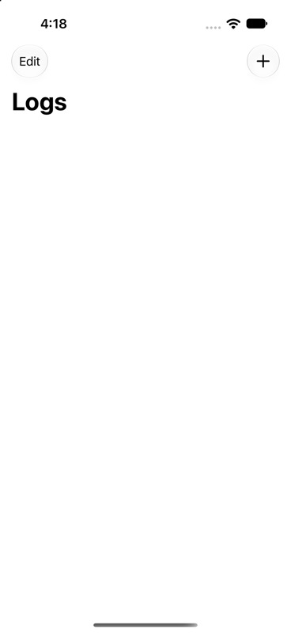
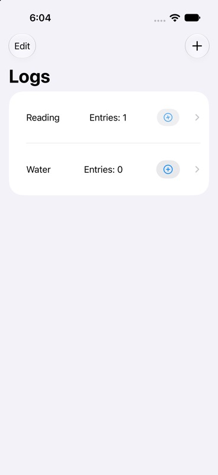
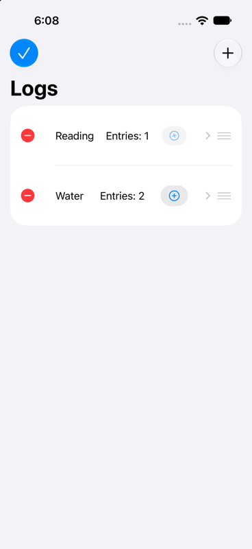
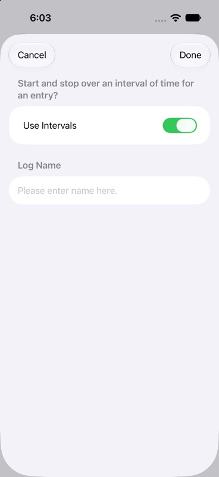
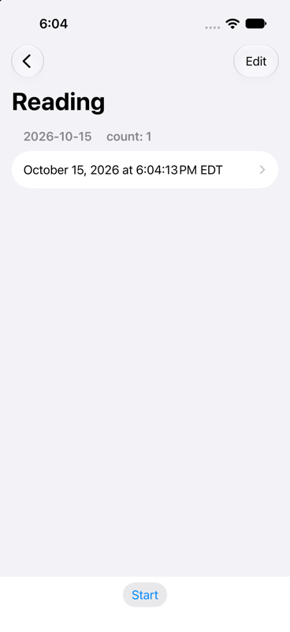
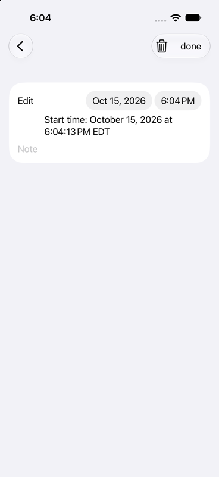
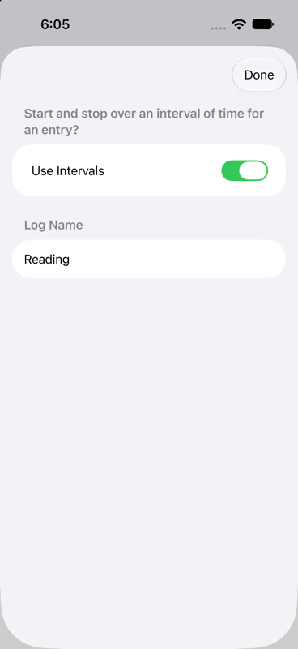

# Design Review: 2026-10-15

A walkthrough of every iOS screen of SimplerLogger, measured against Apple's
Human Interface Guidelines.

- **Build:** `revive-wip`, after the `LogView.swift:129` build fix
- **Device:** iPhone 17 simulator, iOS 27
- **Not covered:** the watch app (it has no data yet) and the in-log Add button (it
  crashes; see `SPEC.md`)

The app uses standard SwiftUI lists, sheets and navigation, so it picks up the current
system look automatically. The problems are mostly visual hierarchy, how state is shown,
and polish.

## Across the whole app

Ordered by impact.

1. **The main action isn't prominent.** Logging something is the whole point of the app,
   but it's a small, light-gray `.bordered` button. On the log screen it's a tiny "Start" at
   the bottom. The HIG says the primary action should be the most prominent control.
   → Use `.borderedProminent` with a large control size, pinned full-width to the bottom of
   the log screen.
2. **A running timer looks disabled.** The only signs are a faded, slowly rotating ➕, and
   faded is how iOS shows "unavailable." There's no elapsed time anywhere.
   → Show it with color, a "Stop" label and a live timer (`Text(start, style: .timer)`).
   Respect Reduce Motion; the current animation repeats forever.
3. **Dates are hard to read.** Entries show "October 15, 2026 at 6:04:13 PM EDT", and
   section headers show "2026-10-15     count: 1".
   → Use "Today"/"Yesterday" section headers, short times ("6:04 PM") and formatted
   durations ("1h 12m").
4. **VoiceOver can't tell the quick-add buttons apart.** Each one is announced only as
   "Add", with no log name and no running/stopped state.
   → Labels like "Log Water" and "Stop Reading timer".
5. **Deleting is unsafe.** Swiping to delete a log erases its whole history with no
   confirmation. On the entry screen, the trash icon shares a button group with "done" and
   doesn't actually delete.
   → Use `confirmationDialog` for destructive actions, and keep Delete away from Save.
6. **No guidance where it's needed.**
   - The first launch is a blank screen. → `ContentUnavailableView` with a "Create your
     first log" button.
   - Tapping Done with an empty name closes the sheet silently. → Disable Done until the
     name is valid.
7. **Inconsistent wording.** "done" is lowercase, the date picker is labeled "Edit", and
   the placeholder says "Please enter name here."
   → Title-case buttons, descriptive labels, and a short placeholder ("Name").

## Screen by screen

### Main list

| Empty (first launch) | Timer running on "Reading" | Edit mode |
|---|---|---|
|  |  |  |

- "Entries: N" floats between `Spacer`s, so it lands in a different spot in each row and
  will collide at large text sizes. → Show the name with a secondary line under it
  ("2 today · last 6:04 PM").
- A running timer is shown only by the faded, rotated ➕ (see the "Reading" row).
- In edit mode, the ➕ button and the chevron still show, crowding the row, and ➕ still
  logs. → Hide them in edit mode.
- Renaming in edit mode never turns on, because `MainRow` keeps its own private
  `editMode` instead of reading the environment.
- New logs are always created with `index = 0`, so their order is undefined.

### New Log sheet

- No title. → "New Log".
- The name should come first and get keyboard focus automatically (`@FocusState`).
- The question "Start and stop over an interval of time for an entry?" works better as
  explanatory text below the toggle (a section footer) than as a heading.
- Done with an empty name dismisses without saving or saying why.
- A form this small suits a `.medium` sheet detent.

### Log screen

- The section header is a raw ISO date plus "count: 1".
- The entry row shows the full long date with seconds and time zone.
- An open interval looks the same as a finished one. There's no "in progress" label and
  no elapsed time.
- The button says **Start** even though this log's timer is running (a state-sync bug,
  `LogViewModel.started`).
- The bottom button bar is white against the gray grouped list. → Use
  `.safeAreaInset(edge: .bottom)` with a material background and a prominent button.

### Entry details

- There's no navigation title.
- Everything is in one card: the picker is labeled "Edit", the start time is repeated as
  text underneath, and the note field has no label.
- There's no way to stop a running entry or give it an end time.
- Back and "done" are redundant on a pushed screen, and the trash icon doesn't delete.
- → Use Form sections (Start, End, Duration, Note) that save automatically, with a red
  Delete button at the bottom behind a confirmation dialog.

### Edit Log sheet

- No title, and no Cancel. Changes apply as you make them, so you can't back out.
- The field order matches New Log (toggle first). The name should come first.
- Switching interval mode while a timer is running has no defined behavior. → Disable the
  toggle, or explain what will happen.
- Consider adding "Delete Log" here (red, with confirmation) as an alternative to swiping.

## Suggested order

1. Make the main action prominent and the running state clear (items 1–2). These define
   how the app feels, so settle them before the data-layer rewrite.
2. Dates, VoiceOver labels, empty state and validation (items 3, 4, 6). Quick wins.
3. Rebuild the entry details screen and the two sheets.
4. Wording and visual polish.
